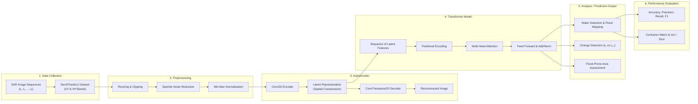

# 📡 Spatio-Temporal Analysis of SAR Imagery using Deep Learning, Transformers & Autoencoders

This project implements an **end-to-end Spatio-Temporal Flood Detection and Analysis System** using **Sentinel-1 Synthetic Aperture Radar (SAR)** imagery from the **Sen1Floods11** dataset. The architecture integrates **Convolutional Autoencoders (CAE)** for spatial feature compression and **Transformer Encoders** for temporal sequence modeling, enabling accurate flood mapping, water detection, change detection, and flood-prone area assessment.

---

## 🏗️ System Architecture



---

## 📓 Notebook Summaries

### 1. [01_Data_and_Feature_Extraction.ipynb](file:///d:/Sar-Spatiotemporal-Analysis/01_Data_and_Feature_Extraction.ipynb)
**Stage 1: Data Preprocessing & Spatial Feature Extraction**
* **Data Ingestion:** Loads dual-polarization Sentinel-1 (S1) SAR imagery (VV & VH bands) and hand-labeled ground truth flood masks using `Sen1FloodsDataset`.
* **Preprocessing Pipeline:** Applies radiometric clipping (`-30` to `0 dB` for VV, `-35` to `-5 dB` for VH), min-max scaling to `[0, 1]`, uniform speckle noise filtering, and spatial resizing to `256×256`.
* **Unsupervised Feature Learning:** Constructs and trains a 5-layer **Convolutional Autoencoder (CAE)** (`ConvAutoencoder`) to learn compact spatial latent features without manual annotation.
* **Model Checkpoint:** Saves pre-trained spatial encoder weights to `models/encoder.pth`.

---

### 2. [02_Temporal_Modeling_and_Prediction.ipynb](file:///d:/Sar-Spatiotemporal-Analysis/02_Temporal_Modeling_and_Prediction.ipynb)
**Stage 2: Temporal Modeling & Transformer Prediction**
* **Temporal Sequence Preparation:** Groups multi-temporal SAR images into sequences of length $T$ using `TrueTimeSeriesSARDataset` to model backscatter dynamics over time.
* **Hybrid Spatial-Temporal Architecture:** Instantiates `TemporalTransformerPredictor`, combining:
  * Pre-trained **Spatial Encoder** (from Stage 1) to extract per-frame latent feature representations ($256 \times 8 \times 8$).
  * **Positional Encoding & Transformer Encoder:** Applies multi-head self-attention to model long-term temporal dependencies across SAR image sequences.
  * **Decoder Prediction Head:** Transposes temporal embeddings back to full-resolution binary segmentation masks.
* **End-to-End Training:** Trains the Transformer model with cross-entropy loss, Adam optimizer, validation splits, and early stopping. Saves `models/best_temporal_model.pth`.

---

### 3. [03_SpatioTemporal_Analysis_Outputs.ipynb](file:///d:/Sar-Spatiotemporal-Analysis/03_SpatioTemporal_Analysis_Outputs.ipynb)
**Stage 3: Spatio-Temporal Analysis, Change Maps & Insights**
* **Model Inference:** Loads `best_temporal_model.pth` to generate high-confidence water/non-water classification masks.
* **Dual-Polarization RGB Composites:** Renders SAR $VV, VH, VV-VH$ false-color composites alongside predicted flood maps.
* **Temporal Change Detection:** Compares predictions between time steps ($t_n$ vs $t_{n-1}$) to create a 4-class change map:
  * 🟩 **No Water** | 🟦 **Permanent Water** | 🟥 **New Flood** | 🟨 **Receded Water**
* **Quantified Insights:** Computes flood surface area ($\text{km}^2$) and measures flood expansion/recession rates for environmental decision support.

---

### 4. [sar_spatiotemporal_analysis.ipynb](file:///d:/Sar-Spatiotemporal-Analysis/sar_spatiotemporal_analysis.ipynb)
**Monolithic End-to-End Baseline & Benchmark**
* **Full Pipeline Execution:** Single self-contained notebook executing data download, preprocessing, autoencoder pre-training, spatial feature extraction, Random Forest classification, and complete evaluation metrics (Confusion Matrix, F1-Score, IoU/Jaccard Index).

---

## 🗂️ Clean Project Directory Structure

```
Sar-Spatiotemporal-Analysis/
├── 01_Data_and_Feature_Extraction.ipynb      # Stage 1: Preprocessing & Autoencoder
├── 02_Temporal_Modeling_and_Prediction.ipynb  # Stage 2: Temporal Transformer Model
├── 03_SpatioTemporal_Analysis_Outputs.ipynb   # Stage 3: Change Analysis & Reports
├── sar_spatiotemporal_analysis.ipynb          # Monolithic baseline notebook
│
├── dataset.py                                 # PyTorch Datasets & Speckle Preprocessing
├── models.py                                  # Autoencoder, Transformer & Spatial Encoder
├── train.py                                   # Training loops & Early Stopping logic
├── utils.py                                   # Seed configuration & Config loaders
├── config.json                                # Model & training hyperparameters
├── README.md                                  # Project documentation
│
├── data/                                      # Sen1Floods11 sample dataset
└── models/                                    # Saved PyTorch checkpoints (.pth)
```

---

## 📊 Pipeline Flow Summary

```
Sen1Floods11 Dataset (SAR VV & VH Imagery)
    ↓
[Stage 1] Preprocess (Denoise, Clip, Normalize) ➔ Train ConvAutoencoder ➔ Save encoder.pth
    ↓
[Stage 2] Latent Sequence Extraction ➔ Transformer Encoder + Attention ➔ Train temporal model
    ↓
[Stage 3] Inference ➔ Water Segmentation ➔ Spatio-Temporal Change Maps ➔ Flood Rate Metrics
```
