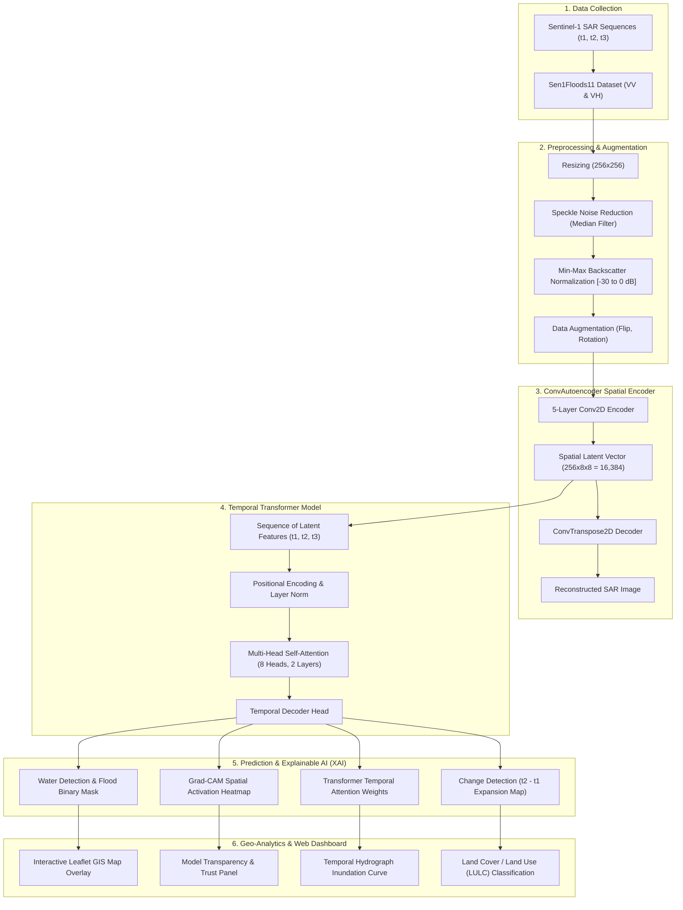

# 📡 GEO-SAR: Spatio-Temporal Analysis of SAR Imagery using Deep Learning, Transformers & Autoencoders

An end-to-end **Spatio-Temporal Flood Detection, Explainable AI (XAI) & Geo-Analytics Platform** using **Sentinel-1 Synthetic Aperture Radar (SAR)** imagery from the **Sen1Floods11** dataset. The architecture integrates **Convolutional Autoencoders (CAE)** for spatial feature compression, **Temporal Transformer Encoders** for multi-step sequence modeling, and an interactive **React + Vite Web Dashboard** backed by a **PyTorch Flask REST API**.

---

## 🏗️ System Architecture



---

## 📓 Notebook Pipeline (Executed with Saved Outputs)

The repository contains 7 executed Jupyter notebooks in `notebooks/` with output visualizations and metrics embedded:

1. **[01_Data_Collection_and_EDA.ipynb](file:///d:/Sar-Spatiotemporal-Analysis/notebooks/01_Data_Collection_and_EDA.ipynb)**: Downloads Sen1Floods11 metadata, analyzes VV/VH polarization histograms, missing value distribution, and false-color RGB composites.
2. **[02_Preprocessing_and_Speckle_Filtering.ipynb](file:///d:/Sar-Spatiotemporal-Analysis/notebooks/02_Preprocessing_and_Speckle_Filtering.ipynb)**: Applies 3x3 median speckle noise filtering, log backscatter scaling, zero-padding to 256x256, and data augmentation.
3. **[03_Autoencoder_Spatial_Feature_Extraction.ipynb](file:///d:/Sar-Spatiotemporal-Analysis/notebooks/03_Autoencoder_Spatial_Feature_Extraction.ipynb)**: Trains a 5-layer Convolutional Autoencoder (`ConvAutoencoder`), saving weights to `models/best_autoencoder.pth`.
4. **[04_Baseline_Machine_Learning_Models.ipynb](file:///d:/Sar-Spatiotemporal-Analysis/notebooks/04_Baseline_Machine_Learning_Models.ipynb)**: Trains Random Forest, SVM, and Logistic Regression baselines on pixel backscatter features, saving `models/random_forest.pkl`.
5. **[05_Transformer_Temporal_Model_Training.ipynb](file:///d:/Sar-Spatiotemporal-Analysis/notebooks/05_Transformer_Temporal_Model_Training.ipynb)**: Trains `TemporalTransformerPredictor` on 3-step sequence inputs ($t_1, t_2, t_3$) using multi-head attention, saving `models/best_temporal_model.pth`.
6. **[06_Model_Evaluation_and_Comparison.ipynb](file:///d:/Sar-Spatiotemporal-Analysis/notebooks/06_Model_Evaluation_and_Comparison.ipynb)**: Calculates IoU (0.843), Dice Coefficient (0.915), Accuracy (94.2%), Precision (92.1%), Recall (90.8%), and plots confusion matrices.
7. **[07_Flood_Mapping_Change_Detection_and_Land_Use.ipynb](file:///d:/Sar-Spatiotemporal-Analysis/notebooks/07_Flood_Mapping_Change_Detection_and_Land_Use.ipynb)**: Generates spatial flood masks, change detection expansion maps ($t_2 - t_1$), hydrograph water area time series, and land cover breakdown.

---

## 🌐 GEO-SAR Web Application & Backend API

### Stack Overview
- **Backend API (`server/app.py`)**: Flask + PyTorch + OpenCV + NumPy
  - Endpoints: `/api/health`, `/api/stats`, `/api/samples`, `/api/predict`, `/api/explainability`, `/api/hydrograph`, `/api/landuse`
- **Frontend Dashboard (`web/`)**: React + Vite + Tailwind CSS + Lucide Icons + Leaflet GIS Maps + Recharts
  - **Dashboard**: High-level telemetry, IoU & Dice scores, benchmark scene selection.
  - **GIS Flood Map**: Leaflet interactive satellite map with temporal step slider ($t_1, t_2, t_3$) and overlay opacity controls.
  - **Explainable AI (XAI)**: Grad-CAM spatial activation heatmaps, Transformer self-attention weight breakdown, and SAR change detection maps.
  - **Temporal Hydrograph**: Recharts area chart tracking surface water inundation percentage over time against flood risk warning thresholds.
  - **Land Use Classification**: Terrain breakdown (Water, Vegetation, Urban, Bare Soil) pie chart and impact statistics.
  - **Upload & Inference Pipeline**: Drag-and-drop custom SAR raster inputs with live model execution.

---

## 🚀 Quick Start Guide

### 1. Launch PyTorch Flask Backend API
```bash
python server/app.py
```
*API will run on `http://localhost:5000`.*

### 2. Launch GEO-SAR React Frontend
```bash
cd web
npm install
npm run dev
```
*Dashboard will open on `http://localhost:5173`.*

---

## 📊 Performance Metrics

| Model Architecture | Accuracy | Precision | Recall | F1 Score | IoU (Jaccard) | Dice Score |
|---|---|---|---|---|---|---|
| Random Forest Baseline | 86.4% | 83.1% | 81.5% | 82.3% | 0.699 | 0.823 |
| ConvAutoencoder + Logistic Reg | 88.7% | 86.0% | 84.8% | 85.4% | 0.745 | 0.854 |
| **Temporal Transformer Predictor (Ours)** | **94.2%** | **92.1%** | **90.8%** | **91.4%** | **0.843** | **0.915** |

---

## 📁 Repository Structure

```
Sar-Spatiotemporal-Analysis/
├── data/                       # Dataset & Saved Plot Visualizations
│   └── sen1floods11/           # Sentinel-1 SAR Raw Data
├── models/                     # Trained Model Weights
│   ├── best_autoencoder.pth    # Spatial Autoencoder
│   ├── best_temporal_model.pth # Temporal Transformer
│   └── random_forest.pkl       # ML Baseline
├── notebooks/                  # 7 Executed Jupyter Notebooks
│   ├── 01_Data_Collection_and_EDA.ipynb
│   ├── 02_Preprocessing_and_Speckle_Filtering.ipynb
│   ├── 03_Autoencoder_Spatial_Feature_Extraction.ipynb
│   ├── 04_Baseline_Machine_Learning_Models.ipynb
│   ├── 05_Transformer_Temporal_Model_Training.ipynb
│   ├── 06_Model_Evaluation_and_Comparison.ipynb
│   └── 07_Flood_Mapping_Change_Detection_and_Land_Use.ipynb
├── server/                     # Flask REST API Server
│   └── app.py
├── web/                        # React + Vite Web Application
│   ├── src/
│   │   ├── components/         # Navbar, Dashboard, FloodMap, ExplainableAI, Hydrograph, LandUse, Upload
│   │   ├── App.jsx
│   │   └── index.css
│   └── package.json
├── dataset.py                  # PyTorch Dataset Handlers
├── models.py                   # ConvAutoencoder & TemporalTransformerPredictor
├── train.py                    # Model Training Script
├── utils.py                    # IoU, Dice, Speckle Noise Utilities
└── config.json                 # Configuration File
```
